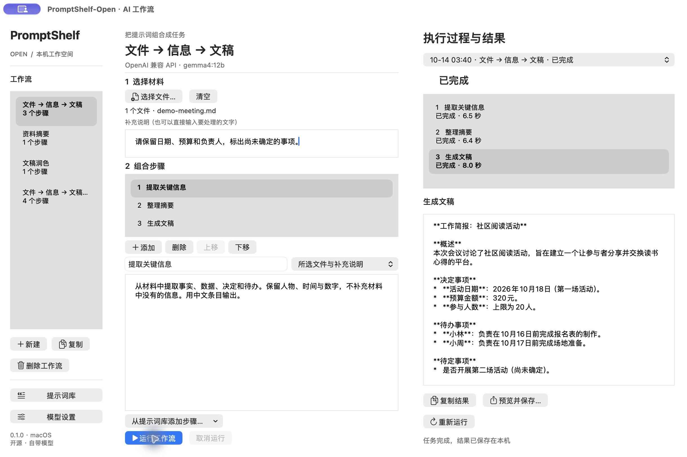
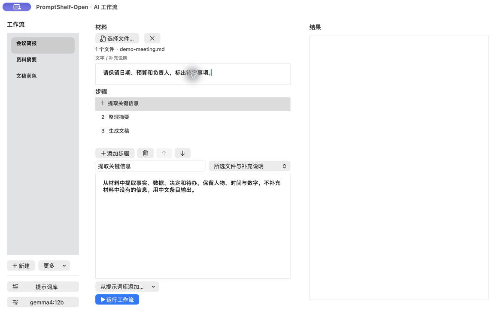
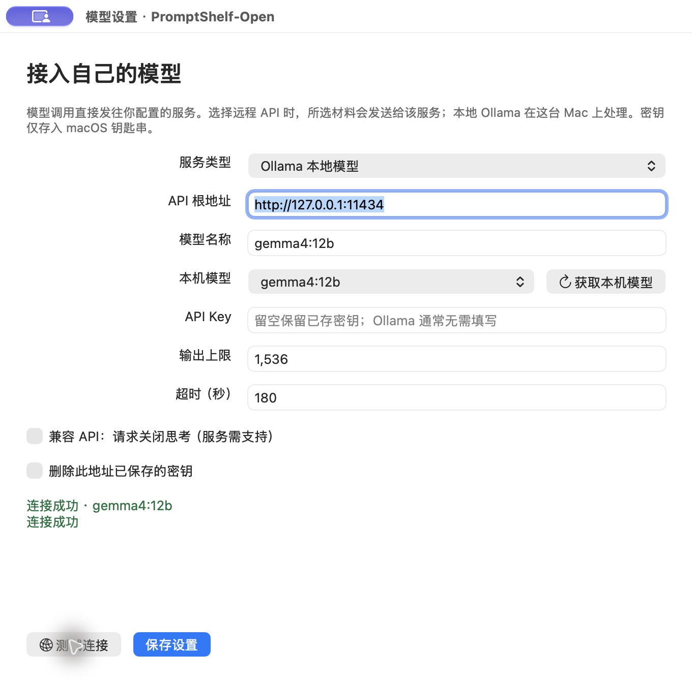
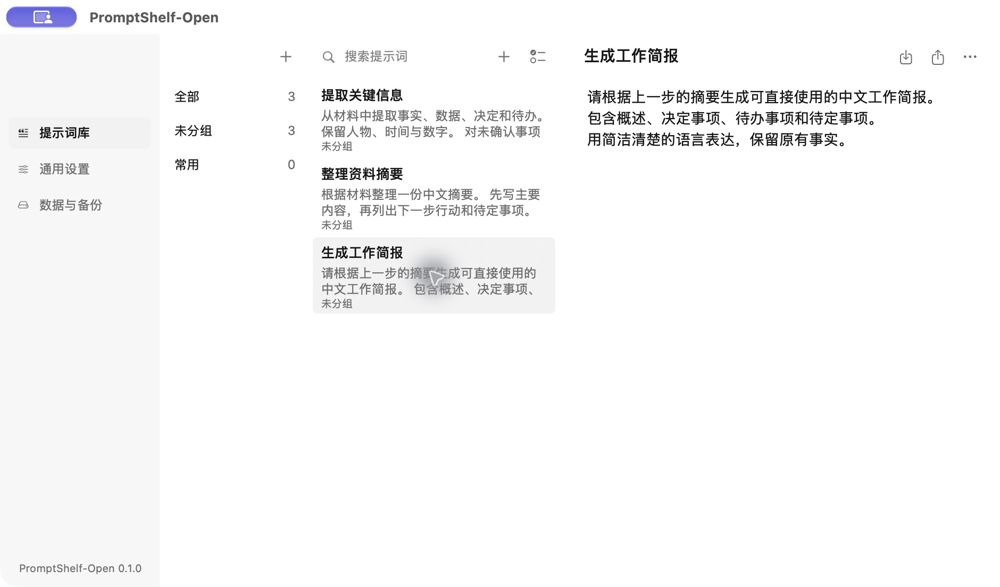
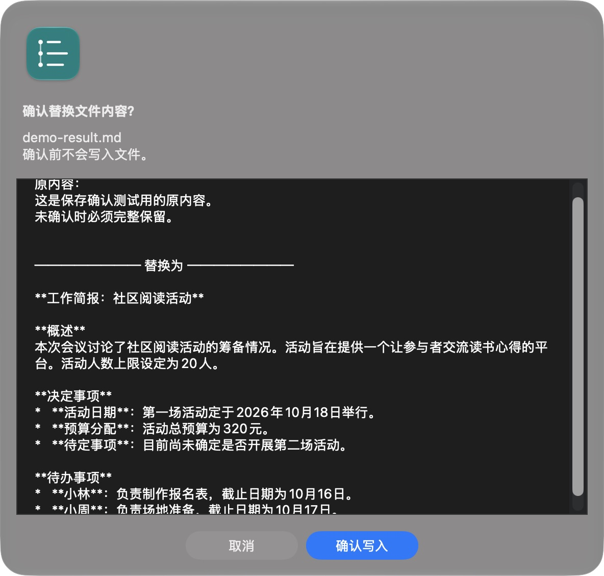

# PromptShelf-Open

把常用提示词组合成能重复执行的任务。一个基于 PromptShelf 的原生 macOS AI 工作流助手，保留提示词库，让你接入自己的本地模型或 API，选择文件，逐步提取信息、整理摘要和生成文稿。

**无需应用账号和订阅。提示词与任务记录保存在本机，模型由你选择。MIT 开源。**

[下载安装包](https://github.com/19991621059/PromptShelf-Open/releases/latest) · [源码构建](docs/BUILD.md) · [实测记录](docs/verification/0.1.0.md) · [安全与隐私](SECURITY.md)



## 真实演示

下图来自已安装的 macOS 应用，使用仓库内的[虚构会议资料](examples/demo-meeting.md)和本地 `gemma4:12b`。等待过程已加速；界面、执行状态和输出均为实际运行，没有使用网页模型或设计稿。



## 可以做什么

- **管理提示词**：分组、搜索、编辑、排序、批量移动，导入导出和本地备份；保留原生浮动提示词入口。
- **接入自己的模型**：本地 Ollama，或支持 OpenAI Chat Completions 协议的 API。填写根地址、模型名称和自己的 API Key，实际测试连接后保存。
- **组合任务**：编辑步骤、调整顺序，直接把提示词库里的提示词加入工作流。每一步可使用所选材料、上一步输出，或两者一起作为输入。
- **处理材料**：选择文本、Markdown、CSV、JSON、代码文件和包含文字的 PDF，也可直接输入文字。内置“文件 → 信息 → 文稿”“资料摘要”“文稿润色”三个可编辑工作流。
- **查看过程**：每一步都有状态、输出和错误；支持取消、重新运行和查看本机历史记录。
- **确认后写入**：源材料只读。保存结果时先展示目标文件的原内容和拟写入内容，点击“确认写入”后才保存。

## 下载与安装

到 [GitHub Releases](https://github.com/19991621059/PromptShelf-Open/releases/latest) 下载：

| 文件 | 用途 |
| --- | --- |
| `PromptShelf-Open-0.1.0-arm64.dmg` | Apple Silicon Mac，打开后拖入 Applications |
| `PromptShelf-Open-0.1.0-arm64.zip` | 相同应用的 ZIP 包，解压后移入 Applications |
| `SHA256SUMS` | 对照安装包的 SHA-256 校验值 |

程序目标为 macOS 13 或更新版本；**0.1.0 安装包实际验证平台为 Apple Silicon / macOS 27.0.1**。Intel 用户可从源码构建，当前没有 Intel 安装包和真机验收记录。

当前发行包采用临时签名，**尚未取得 Apple Developer ID 签名和公证**。外部下载可能被 macOS Gatekeeper 提示或阻止；本机安装启动通过不等于已完成互联网下载后的 Gatekeeper 验收。请先核对来源、校验值和系统提示。代码签名、公证及更多系统版本验证是后续发行工作。

## 第一次运行

### 使用本地 Ollama

1. 安装并启动 [Ollama](https://ollama.com)，准备一个适合自己电脑的模型。
2. 打开应用的“模型设置”，选择“Ollama 本地模型”。根地址通常为 `http://127.0.0.1:11434`。
3. 点击“获取本机模型”，选择已安装模型，点击“测试连接”。看到实际生成的连接结果后保存设置。
4. 选择“文件 → 信息 → 文稿”，添加自己的文件或输入文字，点击“运行工作流”。
5. 查看各步骤输出；需要保存时，点击“预览并保存…”，检查预览再确认。



### 使用自己的 API

选择“OpenAI 兼容 API”，填写服务商提供的 **API 根地址**（例如 `https://你的服务地址/v1`）、模型名称和 API Key。应用在根地址后追加 `/chat/completions`；不要填写完整的生成请求路径。远程地址要求 HTTPS，密钥保存在 macOS 钥匙串中。

部分思考模型可勾选“请求关闭思考”，该选项会发送 `reasoning_effort: "none"`，仅适用于支持它的服务。Ollama 的兼容接口说明见[官方文档](https://docs.ollama.com/api/openai-compatibility)。服务商不支持该参数时请取消勾选。

0.1.0 已真实验证 Ollama 原生接口和 Ollama 的 OpenAI 兼容接口；**尚未实测带付费密钥的远程云服务**。模型服务的费用、额度和数据处理政策由所选服务商决定。

## 提示词库与文件确认

点击左侧“提示词库”管理原有提示词功能，编辑后可以从工作流中的“从提示词库添加步骤…”复用。快捷键：`⌘1` 打开工作流，`⌘M` 打开提示词库。





保存只支持 `.md` / `.txt`。取消预览不会修改文件；预览后目标内容变化、路径变成符号链接等情况会拒绝写入，需要重新预览。

## 数据与边界

应用使用独立标识 `io.github.promptshelf.open` 和独立目录 `~/Library/Application Support/PromptShelf-Open/`，不会自动读取或迁移原版 PromptShelf 的库。API Key 不写入工作流 JSON，也不随提示词导出。

开源版移除了登录、订阅支付、私有云同步和云端账号数据库依赖；仍保留本地文件存储，保存提示词、配置和执行记录。使用远程 API 时，你选择的材料会发往该服务；本地 Ollama 在本机处理。

当前工作流按顺序执行，不包含分支、定时执行、网页控制或自动运行命令。执行状态按步骤更新，输出在每一步完成后展示。PDF 需要有可提取的文字，扫描件暂不支持 OCR。单次最多 20 个文件，每个最多 20 MB，PDF 最多 300 页，提取文字总量最多 120,000 字符；模型自身上下文限制仍然适用。输出达到设定上限时会报错，避免把截断的文稿标成完成。

## 从源码构建

需要 Xcode Command Line Tools，无第三方运行时依赖：

```sh
git clone https://github.com/19991621059/PromptShelf-Open.git
cd PromptShelf-Open
./build.sh
open .build.noindex/PromptShelf-Open.app
```

完整构建、隔离回归检查、真实模型检查和打包步骤见 [docs/BUILD.md](docs/BUILD.md)。CI 只验证构建和本地回归，不代表真实桌面、模型或安装验收。

## 许可与贡献

基于 PromptShelf 1.7.4 的本地提示词功能衍生，新增独立模型接入与工作流执行。采用 [MIT License](LICENSE)，资源来源说明见 [THIRD_PARTY_NOTICES.md](THIRD_PARTY_NOTICES.md)。欢迎通过 issue 报告可复现的问题；请勿上传自己的 API Key、提示词库或私人任务材料。
